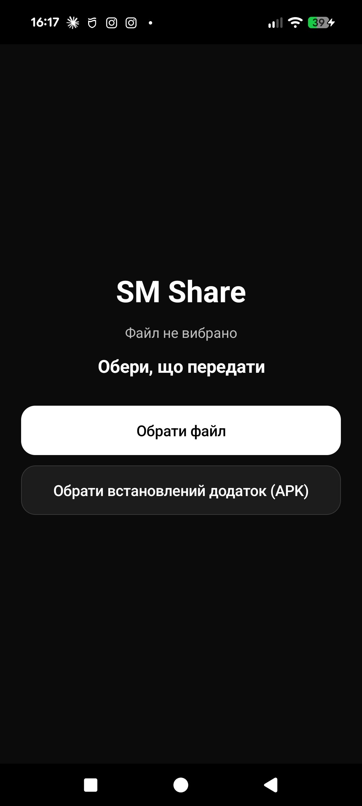

# SM Share

[Українська](README.uk.md)

Send a file or an installed app (APK) from one Android phone to another by tapping them together. Only the sending phone needs the app: the other phone just opens a download link in its browser.

<p>
  
</p>

## How it works

1. Pick a file, pick an installed app (its APK is taken from the system), or use "Share" from any app and choose SM Share.
2. SM Share starts a small HTTP server on the phone that serves only that file.
3. The phone emulates an NFC tag (NFC Forum Type 4, via Host Card Emulation) that contains the download link.
4. The other phone taps the back of this one, its browser opens the link and downloads the file over Wi-Fi.

If NFC does not work, the link is shown on screen and can be typed in by hand.

### Fast mode: Wi-Fi Direct (SM Share on both phones)

"Fast: Wi-Fi Direct" makes the sending phone create its own 5 GHz Wi-Fi Direct network (no router, no internet). Tap the phones: NFC passes the network and link, the receiving phone (Android 10+, SM Share open) joins it, confirms the system "connect" prompt, and saves the file to Downloads. Typically 10-30 MB/s, versus about 0.2 MB/s over Bluetooth.

### Without internet or Wi-Fi: Bluetooth

The "Send via Bluetooth" button hands the same file to the system Bluetooth share (OBEX Object Push). Nothing needs to be installed on the other phone: pair the phones, accept the incoming file there. The Wi-Fi/NFC way also works without internet if both phones are on one hotspot.

## Requirements

- Sending phone: Android 8+, NFC with HCE (most phones with NFC)
- Receiving phone: NFC turned on, unlocked, any browser
- Both on the same Wi-Fi, or the receiver connected to the sender's hotspot
- To install an APK on the receiver, its browser needs "Install unknown apps" permission

Apps split into several APKs (some Play Store apps) are not listed, because a single APK from them will not install.

## Tech

- Java, Android SDK only, no dependencies, no Gradle
- `NdefHceService` - NFC Type 4 tag emulation (`HostApduService`)
- `Share` - the file server (plain `ServerSocket`) and the NDEF message
- `MainActivity` - UI built in code
- minSdk 26, targetSdk 34, APK size about 25 KB

## Build

Needs JDK 17+ and Android SDK (`platforms;android-34`, `build-tools;34.0.0`).

```sh
export ANDROID_HOME=/path/to/android-sdk
export SM_KS_PASS=your-keystore-password   # a keystore is created on first run if missing
sh build.sh
```

## Author

S-Mykhailo - [@savchenko_mykhailo](https://t.me/savchenko_mykhailo)

## License

GPL-3.0-or-later. You can use, change and share this code, but any modified version you distribute must also be open source under the GPL. See [LICENSE](LICENSE).
