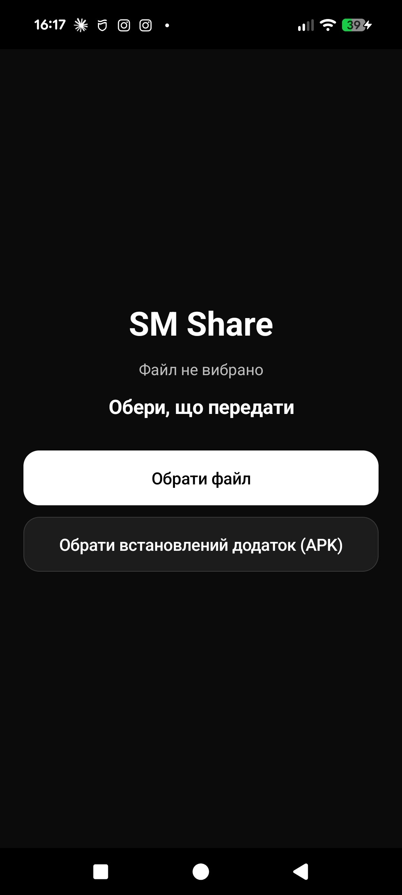

# SM Share

[English](README.md)

Передача файлу або встановленого додатку (APK) з одного Android-телефона на інший: прикладаєш телефони, і файл іде. Застосунок потрібен тільки на телефоні, з якого передаєш: на другому просто відкривається посилання в браузері.

<p>
  
</p>

## Як працює

1. Обираєш файл, встановлений додаток (його APK береться з системи) або тиснеш "Поділитися" в будь-якому застосунку і вибираєш SM Share.
2. SM Share запускає на телефоні маленький HTTP-сервер, який віддає тільки цей файл.
3. Телефон прикидається NFC-міткою (NFC Forum Type 4, через Host Card Emulation) з посиланням на скачування.
4. Другий телефон прикладаєш до спини першого, в ньому відкривається браузер і качає файл через Wi-Fi.

Якщо NFC не спрацює, посилання видно на екрані, його можна ввести вручну.

### Швидкий режим: Wi-Fi Direct (SM Share на обох телефонах)

Кнопка "Швидко: Wi-Fi Direct" створює на телефоні, з якого передаєш, власну Wi-Fi Direct мережу на 5 ГГц (без роутера й інтернету). Прикладаєш телефони: NFC передає мережу й посилання, другий телефон (Android 10+, SM Share відкритий) підключається, ти підтверджуєш системний запит, і файл зберігається в Завантаження. Зазвичай 10-30 МБ/с, а через Bluetooth близько 0,2 МБ/с.

### Без інтернету і Wi-Fi: Bluetooth

Якщо SM Share є на обох телефонах: на приймачі тисни "Отримати по Bluetooth" (він стає видимим на 5 хвилин), на відправнику "Передати через Bluetooth" і вибери приймач зі списку. Без пари і без системного вікна обміну: приймач підтверджує файл, SM Share передає його і зберігає в Завантаження. Bluetooth Classic повільний (приблизно 0,1-0,25 МБ/с), для великих файлів краще Wi-Fi Direct.

Для телефона без SM Share обери у списку "Телефон без SM Share": файл піде у системний Bluetooth-обмін (OBEX), телефони треба з'єднати і прийняти файл там.

### Перевірка безпеки

Кожен отриманий файл перевіряється перед збереженням (офлайн, читається лише початок файлу): підроблені розширення (`photo.jpg.apk`), виконуваний код під виглядом медіа, приховані символи в імені та APK з ризикованими дозволами (SMS, доступність, адмін пристрою, поверх екрана, читання сповіщень). Небезпечні файли видаляються, сумнівні лишаються з попередженням і самі не відкриваються. Це не справжній антивірус: бази сигнатур вірусів нема, тому добре зроблений вірус він не впіймає. Встановлюй додатки тільки від тих, кому довіряєш.

## Що потрібно

- Телефон, з якого передаєш: Android 8+, NFC з HCE (є в більшості телефонів з NFC)
- Другий телефон: увімкнений NFC, розблокований, будь-який браузер
- Обидва в одній Wi-Fi, або другий підключений до точки доступу першого
- Щоб встановити APK на другому телефоні, браузеру треба дозвіл "Встановлювати невідомі додатки"

Додатки, розбиті на кілька APK (деякі з Play Маркету), у списку не показуються, бо один файл з них не встановиться.

## Технічне

- Java, тільки Android SDK, без залежностей і без Gradle
- `NdefHceService` - емуляція NFC-мітки Type 4 (`HostApduService`)
- `Share` - сервер файлу (звичайний `ServerSocket`) і NDEF-повідомлення
- `MainActivity` - інтерфейс, зібраний у коді
- minSdk 26, targetSdk 34, APK близько 25 КБ

## Збірка

Потрібні JDK 17+ і Android SDK (`platforms;android-34`, `build-tools;34.0.0`).

```sh
export ANDROID_HOME=/шлях/до/android-sdk
export SM_KS_PASS=пароль-keystore   # якщо keystore немає, він створиться при першому запуску
sh build.sh
```

## Автор

S-Mykhailo - [@savchenko_mykhailo](https://t.me/savchenko_mykhailo)

## Ліцензія

GPL-3.0-or-later. Код можна використовувати, змінювати і поширювати, але будь-яка змінена версія, яку ти поширюєш, теж має бути відкритою під GPL. Див. [LICENSE](LICENSE).
